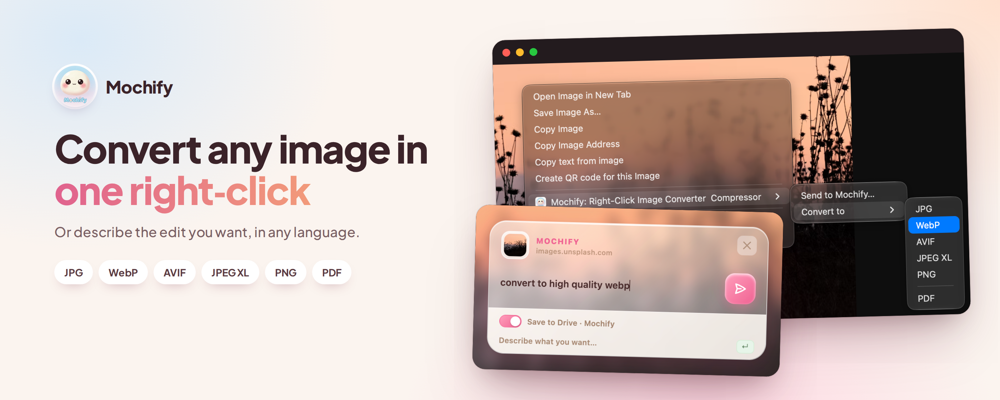

<h1>Mochify for Chrome</h1>

Right-click any image on the web to resize, convert, and optimize it with
[Mochify](https://mochify.app) — either from a format menu, or from a plain-English prompt.

**[Install from the Chrome Web Store →](https://chromewebstore.google.com/detail/mochify-%E2%80%93-ai-image-compre/pgegchhkcjdcnnppeahkdcalclpaamcj)**

---

## Features

- **Quick convert** — *Convert to ▸ JPG / WebP / AVIF / JPEG XL / PNG / PDF* skips the prompt entirely. The format is the whole instruction, so there's no parse step: one request, no typing. Quality stays on auto and nothing is resized.
- **Plain-English prompts** — *"convert to webp at 800px wide"*, *"make it a square avatar"*, *"compress for web"*. Parsed into concrete compression parameters by Mochify's NLP worker.
- **Multi-size / multi-format fan-out** — ask for several sizes or formats in one prompt. They go up as a single request, expand server-side, and come back as one `.zip`.
- **Image → PDF** — say *"pdf"* and the image comes back as a one-page PDF. Works on every plan, including Free.
- **The full processing toolkit** — smart compression, smart crop, EXIF stripping, background removal, HDR gain maps, lossless encoding, drop shadows, brightness/rotation/clarity: the same options the web app sends, with the same parameters.
- **Save to Google Drive** — if the account has a Drive connected on mochify.app, the overlay grows a toggle and results go straight there instead of the downloads folder.
- **Optional sign-in** for higher monthly limits. Signed-out use runs on the anonymous tier; background removal works there too, while drop shadows and generated backgrounds need a paid plan.

## How it works

A standard Manifest V3 extension with no build step:

| File | Role |
| --- | --- |
| `manifest.json` | Permissions, background worker, popup. |
| `background.js` | Service worker. Routes all API calls (to bypass page CSP/CORS), handles the context-menu action, parses prompts, and fans out compression requests. |
| `content.js` | Injects the in-page prompt overlay (shadow DOM). Opens straight into its working state for a quick convert. |
| `prompt/` | Fallback popup window, used when a content script can't be injected. |
| `popup/` | Toolbar popup — sign-in state and account info. |
| `lib/fflate.js` | Unpacks the server's multi-variant response and repacks it under readable filenames. |

### Endpoints

- `api.mochify.app` — image processing (`POST /v1/squish`) and image → PDF (`POST /v1/pdf?op=create`).
- `id.mochify.app` — prompt parsing (`POST /v1/prompt`) and usage/quota checks (`GET /v1/usage`, plus `?integrations=1` for the Drive toggle).

Auth is a per-user bearer token, obtained by signing in at `mochify.app/auth/extension` and stored in `chrome.storage.sync`. No secrets are embedded in the source.

### Prefetching

The quota check, the image download and its dimension decode don't depend on what the user types, so they start when the overlay opens rather than when the prompt is submitted. The image matters most: the NLP parse needs real pixel dimensions to resolve relative intent (*"50%"*, *"9:16"*), which puts the download on the critical path in front of the slowest call in the chain. Moving it into the typing window takes it off that path entirely.

It's best-effort — MV3 can terminate the service worker mid-typing, and some images aren't fetchable from the worker at all — so `processImage()` always stays able to do the whole job itself, and a failed prefetch falls through to the normal path.

### Notes on the Chrome APIs

- Chrome builds a context menu from items registered at install time and gives no `onShown` hook, so a *Convert to* row can't name the source format. The overlay does it once it has the bytes ("WebP → AVIF…").
- The extension never talks to Google directly. Drive uploads use the connection the account already holds, so there's no OAuth here, no Google scope in the manifest, and no extra permission — just `dest=drive&name=…` on the request it was making anyway. It learns a Drive exists only from `GET /v1/usage?integrations=1`.

## Development

No build or bundling step — load the folder directly:

1. Open `chrome://extensions`.
2. Enable **Developer mode** (top-right).
3. Click **Load unpacked** and select this repository's root folder.
4. After editing, click **reload** on the extension card. If you change `host_permissions` in `manifest.json`, remove and re-add the extension so Chrome re-prompts.

## License

[MIT](./LICENSE)
